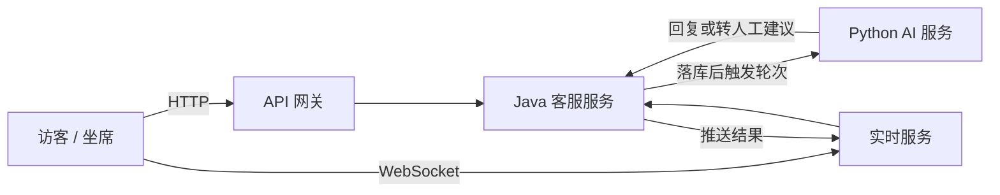

# SupportFlow

SupportFlow 是一个多租户智能客服平台。访客可以从网站客服组件发起咨询，机器人结合企业知识库回答，必要时转交人工。坐席可以在同一个工作台接待、协作、建单和跟进，平台侧负责租户管理、计费和运营。

## 业务功能

- **实时接待**支持访客聊天、ACK 和重连补拉、坐席认领、技能组派单与转接。
- **客服 AI**涵盖文档入库、RAG 引用、意图和情绪识别、多轮会话、回复与转人工建议。
- **客户运营**包括客户档案、会话与工单轨迹、SLA、会话质检和满意度。
- **SaaS 管理**包括企业审核、租户与成员、套餐和用量、平台运营与审计。

## 项目结构

| 目录 | 内容 |
| --- | --- |
| [`backend/`](backend/) | Java 25、Spring Boot 4.0.3。API 网关、实时服务和五个业务服务。 |
| [`ai-service/`](ai-service/) | FastAPI、LangGraph、LlamaIndex 和 PostgreSQL 向量检索。 |
| [`frontend/`](frontend/) | Vue 3、TypeScript、Vite。企业控制台、平台管理端和访客界面。 |
| [`website/`](website/) | 独立产品官网、套餐页面和交互演示。 |
| [`fixtures/knowledge-base/`](fixtures/knowledge-base/) | 可上传到知识库的客服资料，覆盖六种文件格式。 |

## 本地运行

完整的一次性安装和启动步骤见[本地运行指南](docs/local-development.md)。默认入口如下。

| 入口 | 地址 |
| --- | --- |
| 控制台 | [localhost:5173](http://localhost:5173) |
| 官网 | [localhost:5180](http://localhost:5180) |
| API 网关 | [localhost:9090](http://localhost:9090) |
| 实时服务 | `ws://localhost:9096/ws/realtime` |
| AI 健康检查 | [localhost:9100/api/ai/health](http://localhost:9100/api/ai/health) |

想从实现入手，可以先看[架构与核心链路](docs/architecture.md)。

## 验证范围

本地使用真实千问模型，验证了企业开通、知识库入库、访客提问、人工接待及工单结案。另验证了消息重发与重连、双租户隔离、知识库无命中，以及模型出错时的转人工兜底。引用来源可在后台知识问答中核对；访客窗口显示答复正文。
