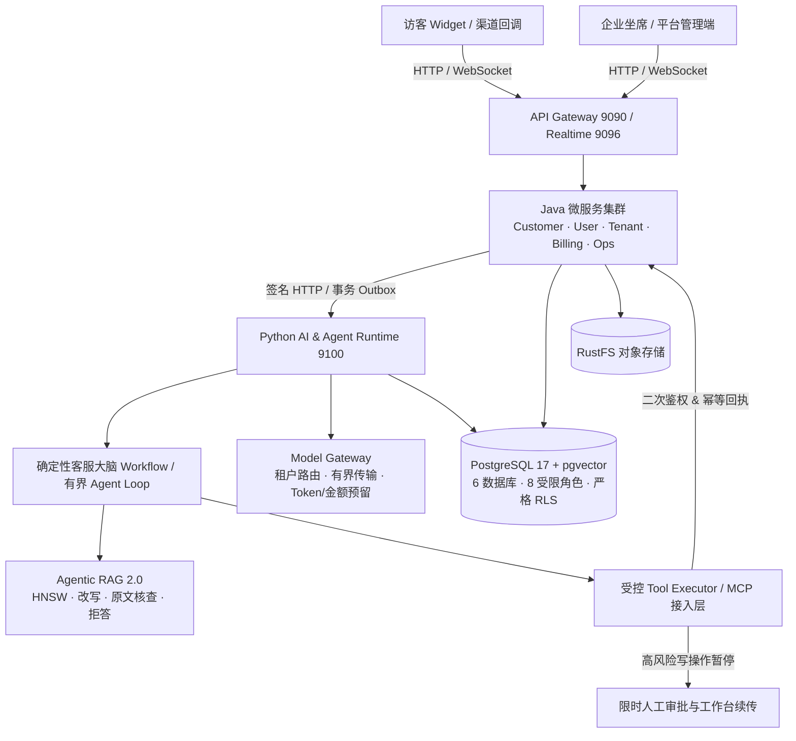

# SupportFlow — 多租户 SaaS 智能客服 Agent 平台

**Multi-tenant Customer Service Agent Platform**

SupportFlow 是一个面向企业智能客服场景构建的多租户 SaaS AI Agent 工程平台。系统在保留确定性多渠道客服接待、工单 SLA 与计费运营闭环的基础上，围绕生产级 Agent 工程能力构建了集**多轮对话、受控工具调用、人工审批（HITL）、知识检索、全链路追踪与成本治理**于一体的可追踪、可恢复服务闭环。

---

## 核心工程定位（六大支柱）

| 工程维度 | 核心能力与架构设计 | 关键源码位置 |
| --- | --- | --- |
| **Agent Runtime** | 持久化 `Run / Step / Payload` 状态机、事务 `Outbox` 投递、数据库租约与递增 `fence`、跨进程崩溃接管、限时人工审批（HITL）及基于不可变业务回执的未知副作用核销。 | [`ai-service/ai/runtime/`](ai-service/ai/runtime/)、`Customer` 侧 Outbox 与回执服务 |
| **Context Engineering** | 系统规则与不可信用户/工具数据隔离、工单规划历史结构化压缩、客服意图字节预算（`Token Budget`）、回合锚定截断及当前轮业务槽位确定性更正。 | [`ai-service/ai/services/brain.py`](ai-service/ai/services/brain.py)、[`ai-service/ai/runtime/ticket_loop.py`](ai-service/ai/runtime/ticket_loop.py) |
| **AI Security** | 六库逻辑隔离 + **8 个非超级用户受限数据库角色** + PostgreSQL `FORCE RLS`（fail-closed）；服务间请求体绑定 HMAC 认证、工具 `Scope` 与实时资源归属复核、单次参数绑定审批消费。 | [`backend/deploy/db-init/40-runtime-roles.sql`](backend/deploy/db-init/40-runtime-roles.sql)、[`ai-service/ai/core/internal_auth.py`](ai-service/ai/core/internal_auth.py) |
| **Agentic RAG & 知识治理** | `pgvector` HNSW 检索、查询改写、低置信度确定性拒答、逐句原文支撑校验、政策数值冲突拦截与转人工建议；知识索引暂存原子切换、过期清理与上一版索引一键回滚。 | [`ai-service/ai/rag/`](ai-service/ai/rag/)、[`KbService.java`](backend/supportflow-customer-service/src/main/java/io/supportflow/customer/service/bot/KbService.java) |
| **Evaluation** | 版本化冻结评测集与留出集、确定性契约门禁与真实模型配对基准（关键词 / 稠密向量 / RRF 混合检索、原文支撑、意图预算、越权与注入回归），接入 GitHub Actions CI。 | [`scripts/benchmarks/`](scripts/benchmarks/)、[`fixtures/evaluation/`](fixtures/evaluation/) |
| **Observability & LLMOps** | 跨 Java/Python 异步请求关联与执行时间线、无副作用离线规划回放、队列积压与延迟快照告警；共用有界模型传输、租户供应商路由、Prompt 版本发布/回退、租户并发配额及日/月 Token 与金额预留。 | [`ai-service/ai/core/`](ai-service/ai/core/)、[`ai-service/ai/runtime/trace_timeline.py`](ai-service/ai/runtime/trace_timeline.py) |

---

## 系统架构总览



---

## 仓库目录导览

```text
SupportFlow/
├── backend/                     # Java 25 + Spring Boot 4.0.3 + Spring Cloud 微服务集群
│   ├── supportflow-common/      # 公共鉴权签名、ScopedValue 租户上下文、只读 Schema Readiness
│   ├── supportflow-gateway/     # API 网关（路由分级、JWT 解析、内部 AI 路径保护）
│   ├── supportflow-realtime-service/  # WebSocket 实时网关（消息 seq/ACK、断线补拉、多节点通知）
│   ├── supportflow-customer-service/  # 核心客服业务（会话、工单 SLA、知识库生命周期、Outbox、审批与回执）
│   ├── supportflow-user-service/      # 账号认证与 RBAC 角色管理
│   ├── supportflow-tenant-service/    # 企业入驻审核、套餐权益与结构升级守卫
│   ├── supportflow-billing-service/   # 幂等用量批次账本与日统计聚合
│   ├── supportflow-ops-service/       # 平台监控、AI 月预算闸门与可观测聚合
│   └── deploy/                  # 六库初始化 SQL、运行角色权限及权威版本化迁移（manifest + baselines）
├── ai-service/                  # Python 3.11+ FastAPI 智能服务与 Agent Runtime
│   ├── ai/agents/               # 客服大脑 LangGraph 工作流
│   ├── ai/rag/                  # Agentic RAG 编排、pgvector/LlamaIndex 检索、原文引用校验与暂存维护
│   ├── ai/runtime/              # 持久化 Agent Runtime、Tool Registry/MCP、HITL 审批、配额预留与追踪回放
│   ├── ai/core/                 # 内部 HMAC 鉴权、有界模型传输、多供应商路由与只读结构门禁
│   ├── ai/services/             # 意图分析、知识问答、会话质检、视觉识别与训练服务
│   └── tests/                   # 分层自动化测试（unit/ 快速契约单测、postgres/ 隔离数据库集成测试）
├── frontend/                    # Vue 3 + TypeScript + Vite 企业工作台、平台端、访客组件及 Playwright 测试
├── website/                     # 独立产品官网与交互演示页
├── fixtures/                    # 知识库多格式测试文档与版本化评测冻结数据集（SHA-256 校验）
├── scripts/                     # 研发与验证工具链
│   ├── *.py                     # 6 个日常本地启动、初始化与数据库迁移主入口
│   ├── lib/                     # 迁移引擎、结构漂移校验、备份恢复与隔离 PG 基础设施库
│   ├── verify/                  # 13 个数据库/跨服务集成验证脚本及测试夹具（fixtures/）
│   ├── benchmarks/              # RAG 检索/回答质量、意图上下文预算与权限边界评测脚本
│   ├── security/                # 全栈受限角色安全流联调辅助模块
│   └── tests/                   # 工具链与评测门禁自身的单元测试
└── docs/                        # 架构设计、本地开发指南、工程进度矩阵、验收记录与 86 份 ADR
```

---

## 快速启动

环境要求：**JDK 25**、**Maven 3.9+**、**Python 3.11+**、**Node.js 22+**、**Docker（PostgreSQL 17 + pgvector / RustFS）**。完整步骤详见 [本地开发与升级指南](docs/local-development.md)。

```powershell
# 1. 生成本地环境密钥、启动 PostgreSQL 并配置受限运行角色与迁移
python scripts/setup-local-env.py
docker compose up -d --wait postgres
python scripts/upgrade-runtime-security.py

# 2. 打包并启动 7 个 Java 微服务（端口 9090–9096）
mvn -B -f backend/pom.xml clean package -DskipTests
python scripts/run-backend.py

# 3. 启动 Python AI 服务（端口 9100）与前端工作台（端口 5173）
python scripts/run-ai.py
npm --prefix frontend ci && npm --prefix frontend run dev
```

---

## 自动化验证与评测入口

所有自动化测试默认使用合成数据、受限数据库角色与确定性模型替身，不依赖外部付费 API 密钥即可复现（详见 [`.github/workflows/verification.yml`](.github/workflows/verification.yml)）：

```powershell
# Java 全模块构建与单元测试
mvn -B -f backend/pom.xml verify

# Python 单元与契约门禁测试
python -m pytest ai-service/tests/unit -q

# 隔离 PostgreSQL 多租户 RLS、Runtime 故障恢复、六库迁移漂移与备份恢复演练
python scripts/verify/test-customer-rls.py --with-ai
python scripts/verify/test-agent-runtime.py --with-java-delivery
python scripts/verify/test-versioned-migrations.py
python scripts/verify/test-database-restore.py --with-attachments --with-services

# 冻结数据集 RAG 质量、原文支撑、检索排序与意图预算基准
python scripts/benchmarks/rag_quality_benchmark.py --comparison grounding --output .local/verification/rag-grounding.json
python scripts/benchmarks/rag_retrieval_benchmark.py --output .local/verification/rag-retrieval.json
python scripts/benchmarks/brain_context_benchmark.py --output .local/verification/brain-context.json
```

---

## 文档导航

- [系统架构与核心链路](docs/architecture.md) — 服务边界、双层 Agent 编排、六库安全隔离与模块映射
- [本地运行与数据库升级指南](docs/local-development.md) — 本地部署、最小权限凭据分发、存量库升级与备份
- [Agent 工程能力矩阵与实施路线](docs/agent-engineering-plan.md) — PR-0～PR-12 与 M01～M12 当前真实能力边界与待收口项
- [架构决策记录索引（ADR 0001–0086）](docs/decisions/README.md) — 按六大工程主题归类的设计取舍与回滚规范
- [可靠性与评测实测验收记录](docs/reliability-verification.md) — 各阶段复现命令、分母口径与报告摘要
